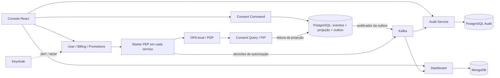

# Consent & Audit Architecture

**Quem pode usar um dado pessoal, para qual finalidade — e como investigar essa decisão depois?**

Projeto pessoal de Renan Rohers que explora essa pergunta com microsserviços, autorização contextual e histórico de consentimento. Nasceu no TCC sobre controle de acesso e auditabilidade de dados pessoais e reúne backend Java, políticas OPA, mensageria e um console React para demonstrar o fluxo completo.

Java 21 · Spring Boot · React · TypeScript · PostgreSQL · MongoDB · Kafka · Keycloak · Open Policy Agent · Docker Compose

[Executar localmente](#executar-localmente) · [Diagramas e decisões](docs/architecture.md) · [Roteiro de demonstração](docs/demo.md) · [Frontend](https://github.com/consent-audit-arch/consent-frontend)

## O que o projeto demonstra

- Concessão e revogação por titular, categoria de dado e finalidade.
- Autenticação JWT e chamadas entre serviços com identidade M2M.
- Aplicação de políticas nos métodos protegidos por um PEP compartilhado, com OPA como PDP e consulta de consentimento como PIP.
- Event Sourcing para preservar as mudanças do consentimento e reconstruir seu histórico.
- Registros de decisões de autorização correlacionados ao histórico no instante do acesso.
- Cenários de cobrança e promoções, métricas e linha do tempo pelo console.

## Arquitetura



O comando atualiza eventos, projeção e outbox na mesma transação. O PIP lê essa projeção diretamente: a próxima decisão após o commit não precisa aguardar a propagação pelo Kafka. Auditoria e métricas são atualizadas de forma assíncrona.

Os [diagramas detalhados](docs/architecture.md) explicam os caminhos de autorização, persistência e revogação, incluindo seus limites.

## Repositórios

Este repositório é a porta de entrada e reúne a orquestração local.

| Componente | Responsabilidade |
| --- | --- |
| [consent-command-service](https://github.com/consent-audit-arch/consent-command-service) | Comandos, event store, projeção e outbox |
| [consent-query-service](https://github.com/consent-audit-arch/consent-query-service) | Consultas e PIP |
| [tcc-security-starter](https://github.com/consent-audit-arch/tcc-security-starter) | Biblioteca de enforcement e auditoria |
| [user-service](https://github.com/consent-audit-arch/user-service) | Dados pessoais de demonstração |
| [billing-service](https://github.com/consent-audit-arch/billing-service) | Cenário de cobrança |
| [promotions-service](https://github.com/consent-audit-arch/promotions-service) | Cenário de promoções |
| [audit-service](https://github.com/consent-audit-arch/audit-service) | Trilha e reconstrução histórica |
| [dashboard-service](https://github.com/consent-audit-arch/dashboard-service) | Métricas projetadas no MongoDB |
| [consent-frontend](https://github.com/consent-audit-arch/consent-frontend) | Console de demonstração |

## Executar localmente

Pré-requisitos: Git com acesso SSH ao GitHub, Docker com Compose v2, Java 21, Maven, Bash, `curl` e `jq`. O frontend é compilado dentro do Docker; para desenvolver a interface fora dele, use Node.js 20.19+ e npm.

### 1. Obter os repositórios

```bash
mkdir consent-audit-arch
cd consent-audit-arch
git clone git@github.com:consent-audit-arch/infra.git
cd infra
bash scripts/clone-repositories.sh
cp .env.example .env
```

O script clona os demais componentes ao lado de `infra`. Os nomes locais `frontend` e `promotion-service` correspondem a `consent-frontend` e `promotions-service` no GitHub. Diretórios existentes são preservados.

O `.env.example` contém valores exclusivamente de demonstração e tags para builds locais. O `.env` é ignorado pelo Git. Os bancos de user, billing e promotion devem manter as credenciais de demonstração coerentes com as URLs e configurações atuais do Compose. Use somente dados fictícios.

### 2. Compilar as imagens e iniciar

Na raiz de `infra`:

```bash
bash build-images.sh
bash up.sh
```

O build instala o starter no Maven local e compila os sete backends. Essa etapa usa `-DskipTests`; para validação, execute `mvn verify` nos módulos conforme seus READMEs. O script `up.sh` constrói o frontend, cria a rede, inicia os containers e configura realm, clients e usuários de demonstração no Keycloak.

### 3. Explorar o console

Abra [localhost:8087](http://localhost:8087). O usuário padrão é `testuser`, com senha de demonstração `testpass`. Há também `auditor1` e `operador1` para comparar perfis. O console usa password grant e entrada automática para a demonstração local.

```bash
bash seed.sh 10
```

A massa também pode ser criada pela página **Massa de Dados**. Siga o [roteiro de demonstração](docs/demo.md) para conceder, acessar, revogar e investigar.

### Operação

```bash
# Status da stack completa
docker compose -f docker-compose.base.yml -f docker-compose.module1.yml -f docker-compose.module2.yml -f docker-compose.module3.yml -f docker-compose.frontend.yml ps

# Logs de auditoria
docker compose -f docker-compose.base.yml -f docker-compose.module1.yml -f docker-compose.module2.yml -f docker-compose.module3.yml -f docker-compose.frontend.yml logs -f audit-service

# Parar preservando os dados
bash down.sh
```

Os volumes persistem entre execuções. A opção `-v` de `down.sh` também remove os volumes e apaga os dados locais.

| Componente | Porta local |
| --- | --- |
| Consent Command / Query | 8080 / 8081 |
| Dashboard / User | 8082 / 8083 |
| Billing / Promotions / Audit | 8084 / 8085 / 8086 |
| Console | 8087 |
| Keycloak / Kafka UI | 8180 / 8070 |
| Kafka / MongoDB | 9092 / 27017 |
| PostgreSQL consent / user / billing / promotion / audit | 5432 / 5433 / 5434 / 5435 / 5436 |

### Se algo falhar

- Confira se Docker está disponível e se as portas estão livres.
- Erro de imagem ausente: execute `bash build-images.sh` e confira as tags no `.env`.
- Erro de autenticação: confira o setup do Keycloak e se o issuer continua sendo `http://localhost:8180/realms/tcc`.
- O `up.sh` usa verificações básicas de disponibilidade; examine os logs e o estado real de saúde caso uma API ainda não esteja pronta.
- Aguarde os consumidores para consultar métricas e auditoria; as duas visões são assíncronas.

## Organização deste repositório

```text
scripts/clone-repositories.sh  Checkout dos componentes lado a lado
build-images.sh               Build das imagens backend
up.sh / down.sh               Inicialização e parada
setup-keycloak.sh             Realm, clients, papéis e usuários demo
seed.sh                       Massa de demonstração
.env.example                  Configuração de exemplo
docker-compose.*.yml         Infra base, módulos 1–3 e frontend
docs/                         Arquitetura e roteiro de exploração
postman_collection.json       Exemplos de chamadas
postman_environment.json      Ambiente Postman de demonstração
```

## Escopo e evolução

O foco é estudar como autorização contextual e histórico de consentimento se conectam em um sistema distribuído. O protótipo cobre um recorte técnico inspirado em requisitos de proteção de dados; não certifica conformidade integral com a LGPD.

Os próximos passos incluem reforçar políticas, identidade e contexto entre serviços, tornar a captura de decisões mais durável, proteger a integridade do histórico e medir o custo da autorização. Veja as [decisões e limitações](docs/architecture.md#limites-e-evolução).
