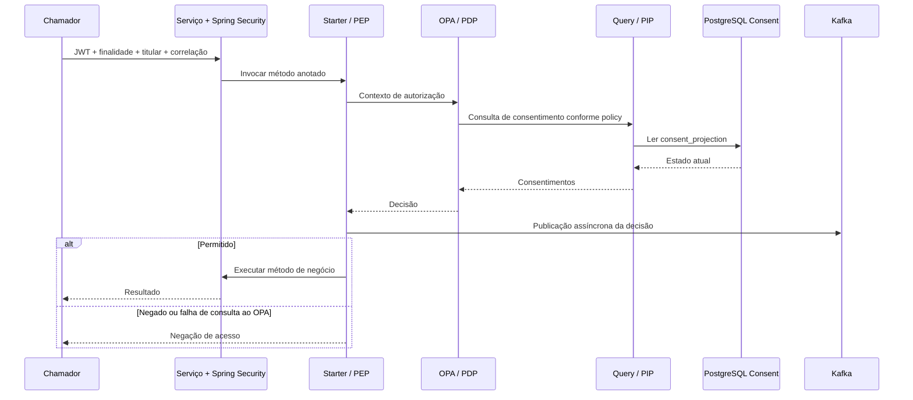
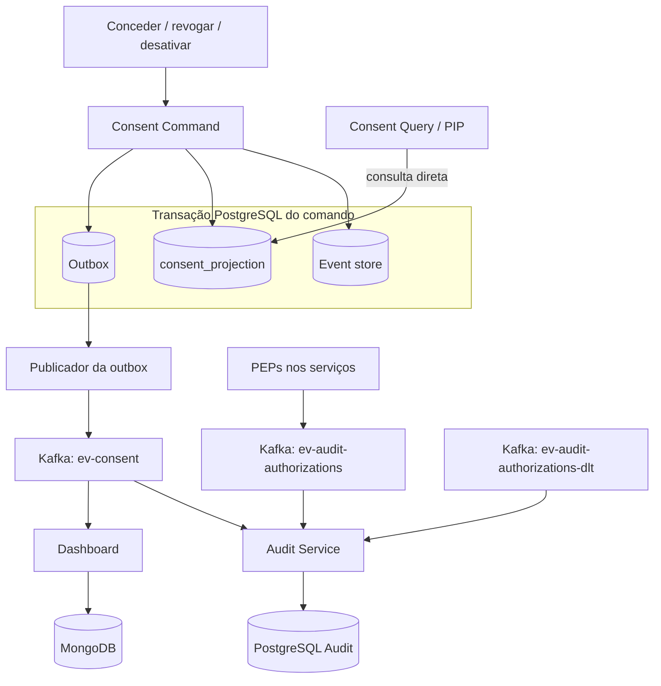
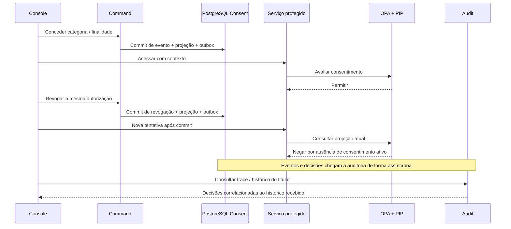

# Arquitetura e decisões

[Voltar ao projeto](../README.md)

Os diagramas Mermaid documentam o fluxo implementado e podem ser editados junto com o código. PEP, PDP e PIP são papéis: a biblioteca PEP é carregada em cada aplicação protegida; OPA executa a política; o query-service fornece o estado do consentimento.

## Autorização contextual

O fluxo de consulta ao PIP depende da política Rego. Há políticas simplificadas com `default allow = true`; a profundidade da autorização varia por serviço. Autenticação JWT é um controle separado. O enforcement se aplica aos métodos anotados, com o controle habilitado.

## Persistência e propagação

A decisão de manter a projeção síncrona aproxima comando e consulta no mesmo banco. Em troca desse acoplamento, novas consultas após o commit não dependem da entrega do evento pelo Kafka. Métricas e auditoria toleram atualização assíncrona.

A outbox do consentimento e a publicação de decisões pelo starter são mecanismos distintos: o segundo não possui uma outbox durável local equivalente.

## Revogação e investigação histórica

O resultado pressupõe endpoint protegido e policy que exige o consentimento correspondente. A revogação afeta novas decisões após o commit; requisições já em andamento e acessos fora desse caminho exigem outros controles.

## Três registros diferentes

| Registro | O que representa |
| --- | --- |
| Evento de consentimento | Mudança no estado do domínio, como concessão ou revogação |
| Decisão de autorização | Avaliação registrada pelo PEP/PDP para um contexto |
| Resultado da operação | Execução efetiva e resultado do método de negócio |

A trilha atual registra decisões antes de executar o método. Uma decisão `ALLOWED` não comprova conclusão do tratamento. No audit-service, a classificação `VIOLATION` pode incluir uma tentativa corretamente negada; seu nome não prova uso indevido consumado.

## Limites e evolução

- **Cobertura de autorização:** aprofundar as políticas simplificadas e verificar a cobertura dos endpoints protegidos.
- **Durabilidade da auditoria:** publicação assíncrona com fallback para DLT pode perder registros em falhas prolongadas; avaliar outbox durável para decisões.
- **Integridade:** eventos são anexados pela aplicação, mas isso não protege o banco contra alterações administrativas; avaliar controles de integridade e retenção.
- **Contexto entre serviços:** finalidade e correlação trafegam em cabeçalhos; reforçar sua origem e proteção contra adulteração.
- **Identidade do console:** migrar o fluxo ativo de demonstração com password grant e sessão local para Authorization Code + PKCE.
- **Consistência:** banco compartilhado no contexto de consentimento e dependência do PIP no caminho crítico; avaliar disponibilidade, concorrência e latência com medições.
- **Operação:** Compose, credenciais de exemplo e configuração Keycloak são voltados à execução local. Medir desempenho e reforçar configuração antes de ampliar o uso.

O consentimento é o recorte escolhido. Cobrança e promoção são cenários de engenharia para exercitar o controle, sem afirmar que a mesma base legal se aplica a todo tratamento real. Expiração de consentimento, eliminação de dados e certificação de conformidade integral não são garantias demonstradas por estes fluxos.
